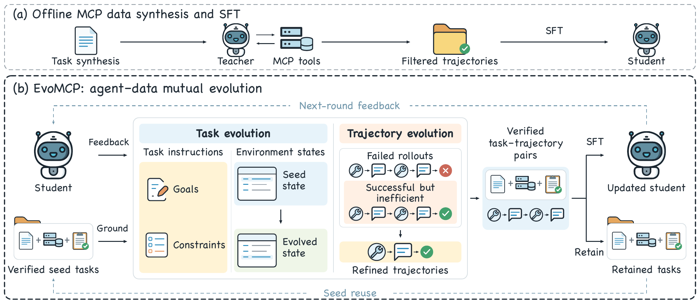

# EvoMCP
### Co-Evolving MCP Agents and Training Data

**A closed loop of task evolution, trajectory evolution, and supervised fine-tuning for MCP agents.**

Xuanang Gao\*, Kepeng Lin\*, Xinyan Shi\*, Yong Deng, Shuheng Shen, Changhua Meng, Xiaofeng Wu, Jie Yang, Wei Liu

Shanghai Jiao Tong University · Ant Group  
\* Equal contribution

[Overview](#overview) · [Method](#method) · [Release Status](#release-status) · [Contact](#contact)

## Overview

Supervised fine-tuning of Model Context Protocol (MCP) agents typically relies on static training data that does not adapt to the student's evolving capabilities. **EvoMCP** co-evolves the agent and its training data: student rollout feedback identifies learning targets, task evolution creates executable tasks, and trajectory evolution produces reliable and efficient demonstrations for the next training round.

## Method

1. **Learn from student feedback.** Assess established capabilities and capability gaps from student rollouts to identify learning targets and compatible verified seed tasks.
2. **Evolve tasks.** Adapt task instructions and observable environment states while keeping instructions, environments, and verifiers aligned.
3. **Evolve trajectories.** Use reusable skills to recover failed teacher rollouts and refine successful ones.
4. **Update the student.** Fine-tune on accepted task–trajectory pairs, retain accepted tasks as seeds, and re-evaluate the student to guide the next round.

The paper evaluates EvoMCP on **Toolathlon**, **MCPMark**, and **MCP-Atlas**.

## Release Status

This repository currently provides the project overview. Implementation, prompts, and examples are being prepared for release.

- [x] Project overview
- [ ] Training and evolution code
- [ ] Prompts and configuration files
- [ ] Task and trajectory examples
- [ ] Evaluation instructions

## Contact

For questions, please contact **Xuanang Gao** at [fangkuar@sjtu.edu.cn](mailto:fangkuar@sjtu.edu.cn), or open an issue in this repository.
